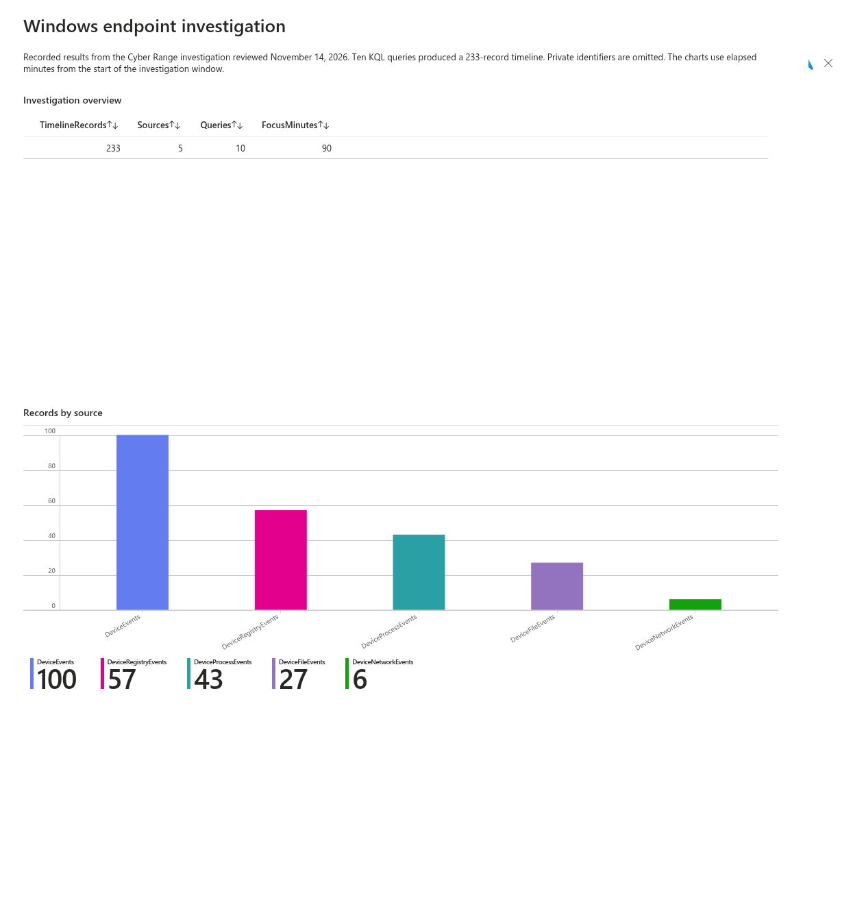

# LOG(N) Pacific | AI Security Engineering

Ryan DeJong · Cybersecurity portfolio

PowerShell automation, vulnerability management, KQL investigations and endpoint response in the LOG(N) Pacific Cyber Range. Each project includes its source, results and screenshots.

Start with the [Windows hardening results](docs/windows-stig-validation.md), [Sentinel workbook](cyber-defense/workbooks/README.md), or [Hartwell Breach investigation](threat-hunting/README.md).

## Projects

| Project | Work and results |
|---|---|
| [Windows 11 STIG automation](stig-remediations/README.md) | Built ten PowerShell remediations with separate verifiers and rollback. All ten selected DISA V2R11 findings changed from FAILED to PASSED in authenticated Tenable assessments. Repeated application and recovery checks also passed. |
| [Vulnerability management](vulnerability-management/README.md) | Completed an assessment cycle on one endpoint and reconciled all 258 compliance items. Documented prioritization, the ten fixes and the remaining findings. Includes a proposed policy and a stakeholder tabletop exercise. |
| [Sentinel investigation workbook](cyber-defense/workbooks/README.md) | Deployed five panels using saved Cyber Range investigation results: 233 timeline records across five Defender tables, activity timing and query coverage. |
| [Authentication detection](cyber-defense/README.md) | Built a KQL detector and Python reference model for repeated failures before a successful logon. All eight generated test cases passed in Log Analytics. Live detection performance remains untested. |
| [Threat hunting](threat-hunting/README.md) | Investigated the Hartwell Breach using seven log sources. Solved all 18 flags, earned all 1,750 points and finished on time. A separate Windows investigation includes ten queries and an incident report. |
| [Defender endpoint response](docs/endpoint-validation.md) | Verified onboarding and central process telemetry, collected an investigation package, and tested isolation and recovery. All 70 collection operations succeeded. |

## Work in pictures

<table>
<tr>
<td width="50%" valign="top"><a href="stig-remediations/README.md"></a><br><strong>Windows hardening:</strong> a local report of the saved Tenable results and Windows checks.</td>
<td width="50%" valign="top"><a href="cyber-defense/workbooks/README.md"></a><br><strong>Sentinel workbook:</strong> source counts and activity from the Windows investigation.</td>
</tr>
</table>

The [screenshot index](docs/visual-evidence.md) explains where each image came from. Private names, credentials, raw logs and challenge answers stay out of the repository.

## Source code

| Area | Source |
|---|---|
| PowerShell | [Shared registry module](stig-remediations/RegistryControl.psm1), [example remediation](stig-remediations/WN11-CC-000010/remediate.ps1), [verifier](stig-remediations/WN11-CC-000010/verify.ps1), [report](stig-remediations/WN11-CC-000010/report.md). |
| Tenable automation | [Scoped API client](stig-remediations/tenable_client.py), [export parser](stig-remediations/nessus_summary.py), [evidence workflow](stig-remediations/evidence-workflow.md). |
| Detection and workbooks | [KQL detector](cyber-defense/auth-sequence.kql), [Python model](cyber-defense/auth_sequence.py), [investigation workbook builder](cyber-defense/workbooks/build_investigation.py). |
| Investigations | [Ten-query catalog](threat-hunting/module-1/README.md#query-index). |
| Deployment checks | [VM specification and offline preflight](deployment/README.md). |

## Validation

The PowerShell harness passed 340 cases on both Ubuntu PowerShell 7.6.6 and Windows PowerShell 5.1. Windows parsed all 32 PowerShell files, and all 33 transferred source hashes matched. The ten remediations were then tested on Windows and assessed through Tenable.

The [validation record](docs/local-validation.md) lists the Python test results, versions and remaining checks. Run the local tests from the repository root:

```bash
python3 -B -m unittest discover -s tests -v
python3 -B tools/check_repository.py
```

These commands use the Python standard library. The separate DISA checks require the cached benchmark archive described in the validation record.

## Scope

The work used authorized Cyber Range systems and data. The audit still has 107 failures, 65 errors and eight warnings beyond the ten remediated controls. Detector fixtures and governance exercises are labeled where used.

AI assistance supported code development, testing and evidence review. Execution was authorized by the operator. AI security systems remain a future area of work. Review records identify the versions examined.

See [project status](docs/project-progress.md), [methodology](docs/methodology.md) and [engineering scope](docs/engineering-scope.md). Raw evidence remains in private storage. LOG(N) Pacific and NCyTE have separate repositories and histories; reuse needs attribution, permission and validation.
