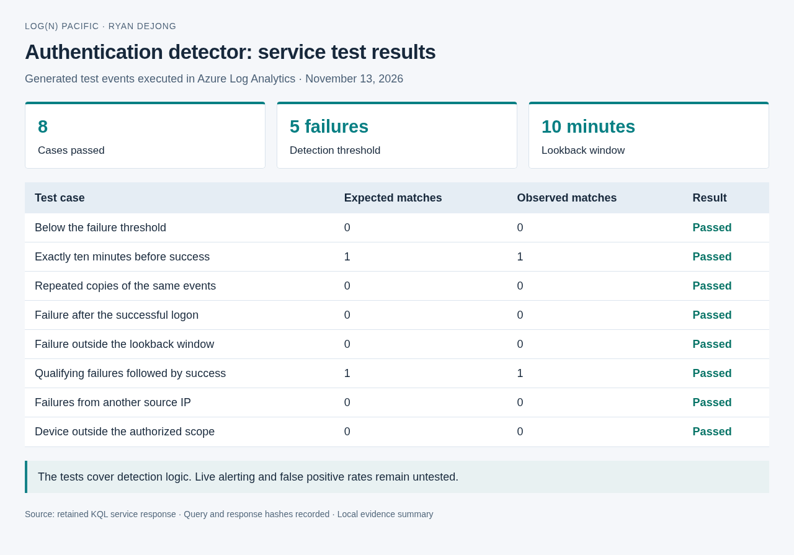

# Authentication sequence detection

[Portfolio](../README.md) · [Sentinel workbook](workbooks/README.md) · [Investigation queries](../threat-hunting/module-1/README.md)

I built a KQL detector for repeated failed logons followed by a successful logon. It looks for at least five failures in the preceding ten minutes on the same device, account, domain, source IP and logon type.

The package includes the query, a Python reference model and eight generated test cases. All eight passed in Azure Log Analytics. Live attack detection and false positive rates remain untested. No alert rule or automated response has been deployed.

## Work completed

| Component | Result |
|---|---|
| KQL detector | Correlates failed and successful logons while retaining the event identifiers. |
| Python model | Checks expected behavior independently of the KQL implementation. |
| Service tests | Eight cases passed, covering the threshold, time boundaries, duplicates and source mismatches. |
| Workbook tests | Five query panels passed. Rendered charts, time controls and empty results were checked in Azure. |



*Observed Log Analytics results from the generated test cases. [Result data and source hashes](detection-validation.json) · [Test workbook](workbooks/authentication-investigation.workbook.json).*

## Detector logic

[auth-sequence.kql](auth-sequence.kql) normalizes account and domain case, excludes missing keys and removes identical projected events. The ten-minute lower bound is inclusive. Failures at or after the successful logon are excluded. An explicit `kind=inner` join retains the matching pairs before aggregation. [Microsoft join reference](https://learn.microsoft.com/en-us/kusto/query/join-inner?view=microsoft-fabric).

The query starts with null times and an empty device list. Set the authorized device and UTC window in a private copy. Include ten minutes of prior events when investigating a success near the window start. Confirm the table schema and the meaning of `LogonFailed` and `LogonSuccess` in the destination workspace.

[auth_sequence.py](auth_sequence.py) checks the same timing rules in memory. Its tests cover identity, source, device, logon type, normalization, missing keys, duplicate events, reused ReportId, ordering and empty scope.

```bash
python3 -B -m unittest discover -s tests -v
```

## Service validation

[kql_fixture.py](kql_fixture.py) renders a query using the detector body and eight generated cases. It replaces the live source and scope parameters with test inputs, then compares expected and returned match counts.

```bash
python3 -B cyber-defense/kql_fixture.py
```

All eight cases passed on November 13, 2026 UTC. The positive and exact-boundary cases each returned one match. Below-threshold, duplicate, late, outside-window, source-mismatch and unscoped cases returned none. The query read only its test datatables.

Private record `EV-KQL-SYNTHETIC-RUNTIME-20261113` retains the query and response. Query SHA-256: `4dc8a7badf7488b15a1f56ca1967d7e6d5dec60e1f54343ed0b60a99daaa1e55`.

The required columns were also observed in the authorized Log Analytics schema. A bounded query found no authentication events for the owned VM. A separate investigation used historical course telemetry. Live authentication coverage needs a further check before deploying this detector.

## Detection limits

Failures from different source IPs or logon types are counted separately. Distributed or source-rotating brute force can evade the threshold. Missing source addresses, incomplete ingestion and fewer than five failures can also cause missed activity.

Mistyped passwords, stale service credentials, retries, shared addresses and approved automation can produce matches. Check the account identity, event details and process context before deciding on a response. Renamed accounts, changed SIDs and conflicting events with the same identifier need additional review.

## Response decisions

| Action | Check first |
|---|---|
| Continue investigation | Confirm device ownership, data coverage and plausible benign causes. Save the query and event references. |
| Propose account containment | Confirm the affected identity, malicious activity, dependencies and approval authority. |
| Propose endpoint containment | Confirm the exact owned endpoint, severity, management access and release plan. |
| Validate recovery | Check endpoint identity, security controls, access and telemetry after the authorized response. |

Containment and credential changes require separate approval. This package runs queries and local tests.

## Related work

- [Windows investigation](../threat-hunting/module-1/README.md): ten queries, a timeline and an incident report from historical telemetry.
- [Sentinel workbook](workbooks/README.md): source counts, activity timing and recorded investigation results.
- [Defender response](../docs/endpoint-validation.md): onboarding, collection, isolation and recovery on the owned VM.
- [Hartwell Breach](../threat-hunting/README.md): the completed web-server hunt.
