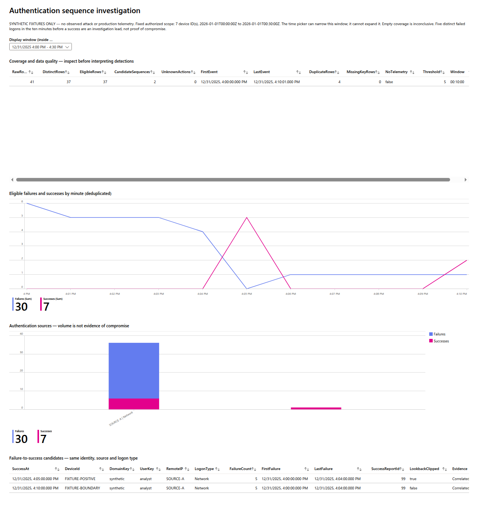

# Authentication investigation workbook

[Portfolio](../../README.md) · [Detector and tests](../README.md) · [Workbook source](authentication-investigation.workbook.json)

I built and deployed a five-panel Azure Monitor workbook for Sentinel investigations. It helps an analyst check whether useful data is present, review failed and successful logons, and inspect the events behind a suspicious sequence. It includes two charts, three tables and a time picker. The [workbook source](authentication-investigation.workbook.json) is available in this repository.

The deployed demonstration uses **synthetic test events**. All five queries ran successfully in Azure Log Analytics on November 14, 2026 UTC. I checked the rendered charts, candidate table, time controls and behavior when no events were present. [Validation results](validation-results.json) record the query hashes and returned counts.



*Actual deployed workbook, captured with portal identity chrome excluded. All events shown are synthetic. This viewport shows coverage, charts and candidates; the event-context panel is below it. [Capture provenance](../../docs/visual-evidence.md).*

## Investigation design

| Panel | Operational use |
|---|---|
| Coverage and data quality | Shows 41 input records, 37 distinct records, four duplicates and two candidates. All 37 distinct records have the fields needed for the check. |
| Authentication timeline | Displays eligible failures and successes per minute. Use timing to identify investigation windows; volume does not establish intent. |
| Source breakdown | Compares failures and successes by source and logon type. Source rotation can split an attack below the detector threshold. |
| Candidate sequences | Reuses the actual reviewed detector body: five failures in the ten minutes before a success for the same device, domain, account, source and logon type. Shows clipped fixed-scope lookbacks. |
| Event context | Lists original event times and ReportIds for each candidate window. Overlapping windows can repeat an event; candidate count is not distinct-event count. |

The [builder](build_workbook.py) reuses the existing [detector](../auth-sequence.kql) and [synthetic fixtures](../kql_fixture.py), checks threshold/window consistency and rejects unexpected source changes. It does not deploy resources or contact Azure. The tests preserve the existing fixture expectations and cover scope rejection, deterministic output, source drift, modes and panel structure.

The design emphasizes temporal correlation and evidence quality. Synthetic fixtures give repeatable positive, negative and exact-boundary cases without inventing geographic or production findings. No shared-workspace data or sample infrastructure identifiers were copied into the artifact.

## Data and authorization

Live mode uses `DeviceLogonEvents` with `Timestamp`, `DeviceId`, `ReportId`, `ActionType`, `AccountName`, `AccountDomain`, `RemoteIP` and `LogonType`. Those columns were observed through a metadata-only schema query in the authorized workspace. The [Microsoft table reference](https://learn.microsoft.com/en-us/azure/azure-monitor/reference/tables/devicelogonevents) documents this source. Table existence does not prove the owned endpoint is onboarded or its events are ingested.

The earlier practice-workspace query returned zero owned-VM authentication events. Subsequent work established the correct endpoint data destination, onboarded the owned VM and observed a benign process event centrally. This does not validate authentication coverage or this detector on live events. The separate [endpoint investigation](../../threat-hunting/module-1/README.md) used actual authorized historical telemetry; it is not supplied by these fixtures.

The builder requires one confirmed 40-hex Defender DeviceId, an explicit workspace resource ID, and an ordered UTC interval of at most 24 hours for live mode. These values remain in a private generated copy. The workbook's fixed filters bound every query; the time picker only narrows the display/query window. Changing the time picker can clip a detection lookback further than the fixed-start marker indicates. Use the complete authorized ten-minute lookback before adjudicating a sequence.

## Reproduce and stage

From the repository root:

```bash
python3 -B cyber-defense/workbooks/build_workbook.py --check
python3 -B -m unittest discover -s tests -p test_workbook.py -v
```

Default generation writes JSON to standard output and makes no other changes. To prepare a workspace-bound synthetic copy after confirming the exact resource, supply `--workspace-resource-id` and redirect output to protected storage outside Git. A live copy additionally requires `--mode live --device-id ... --start ... --end ...`; all values must come from the authorized scope record. Do not place real identifiers into the checked-in default artifact.

For an independently authorized deployment, import the JSON through the workbook Advanced Editor in the approved workspace context, select the approved resource scope if using the generic source, and save exactly one workbook in the approved resource group. Validate the time picker, all five panels, empty-data behavior and permission boundaries. Record resource identity privately, source digest, queries, expected fixture results, UI observations and any errors. No analytics rule, alert, response action, identity or network change is needed. [Microsoft Workbooks overview](https://learn.microsoft.com/en-us/azure/azure-monitor/visualize/workbooks-overview).

The observed deployment used the assigned resource group and an explicitly approved source workspace. Data-read permissions remain separate from workbook write permission. Source updates were applied only to that existing workbook and read back exactly. Any later removal requires authorization; leave the VM, workspace and original evidence intact.

## Validation limits and references

Five service queries returned the expected rows: coverage 1, timeline 11, source breakdown 2, candidates 2 and context 12. Positive and exact-boundary sequences matched; the original negative fixture cases did not. There were 30 deduplicated failures and seven successes in the scoped fixture, with no out-of-scope device included. The [Python reference model](../auth_sequence.py) independently agrees with the two expected candidates.

Portal validation found and corrected two presentation defects: the source chart needed an explicit category axis and both outcome series; the custom time picker needed a positive duration with a fixed end time. Full fixture results survived reload. A recent display interval outside the fixtures showed zero coverage, `NoTelemetry=true` and four empty panels, then the full fixture interval was restored. Live-query performance and actual incident detection remain unvalidated. Local tests check the used workbook structure and behavior; no claim of validation against the entire JSON Schema is made. Missing fields, renamed accounts, incomplete ingestion, distributed sources and benign retries remain limitations. This workbook runs queries only and performs no containment.

The artifact follows Microsoft's [workbook source format](https://github.com/microsoft/Application-Insights-Workbooks/blob/master/schema/workbook.json), [time parameters](https://learn.microsoft.com/en-us/azure/azure-monitor/visualize/workbooks-time) and [chart visualizations](https://learn.microsoft.com/en-us/azure/azure-monitor/visualize/workbooks-chart-visualizations). It is original code, not a copy of confidential lesson JSON. Raw responses and private resource binding remain outside Git under evidence aliases `EV-WORKBOOK-RUNTIME-V16` and `EV-WORKBOOK-V17`.
