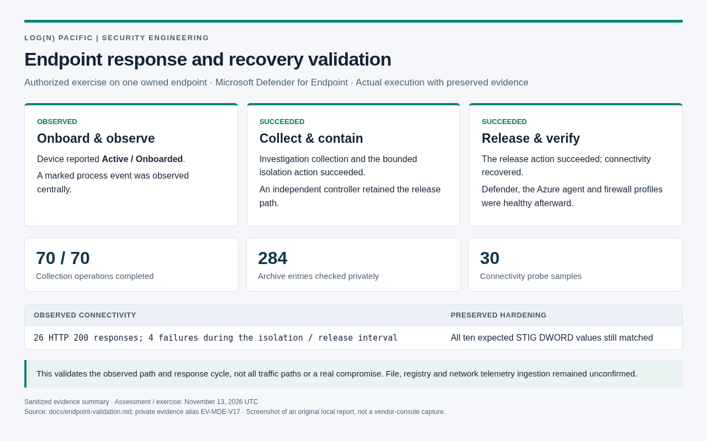

# Endpoint telemetry and response validation

[Portfolio](../README.md) · [Project status](project-progress.md) · [Validation](local-validation.md)

This project validates the response path on an owned Windows 11 Pro 25H2 endpoint: onboard to Defender, observe central telemetry, preserve an investigation package, isolate the device, and verify recovery. The existing VM and networking were preserved. Exact device identities, onboarding material, action records and forensic contents remain in protected private storage under `EV-MDE-V17`.

*Screenshot of an original local report summarizing the observed exercise below. This is not a Defender-console capture. [Image provenance](visual-evidence.md).*

## Observed results

| Layer | Evidence and result |
|---|---|
| Onboarding | The designated Windows onboarding package was hash-checked and executed once. Native Windows PowerShell 5.1.26100.9818 reported onboarding state 1, running Sense/Defender services and a healthy Azure agent. The supported Defender API subsequently reported the exact device as Active and Onboarded. |
| Benign telemetry | A marked process, private test file, temporary nonsecurity registry value and HTTPS HEAD request were exercised. The temporary registry key was removed. The process event was independently observed in the correct central workspace. File, registry and network events were not returned by the bounded follow-up query; local execution is not complete ingestion evidence. |
| Investigation collection | Defender reported the single collection action Succeeded. The private archive contains 284 entries; its summary reports 70 completed operations with zero error codes. Download length, stream-to-disk SHA-256 and ZIP CRC checks passed. No independent vendor-signed package digest was provided. |
| Isolation and recovery | One owned-device isolation action and its immediate release both reported Succeeded through the supported Defender API. The controller ran outside the isolated VM. A 30-sample HTTPS HEAD probe recorded 26 HTTP 200 responses and four failures during the isolation/release interval, with success before and after. This validates that observed path, not every traffic path. Defender, antivirus, the Azure agent and all firewall profiles were healthy afterward. |
| Preserved logs | Six allowlisted Windows execution logs and the final connectivity log were transferred with matching SHA-256 hashes. A final read-only check found all ten expected STIG DWORD values still matching. Onboarding policy material and authentication data were excluded from the portable report. |

## Method and recovery

Confirm exact device identity and healthy onboarding before any response. Preserve evidence, inspect direct/proxy/VPN connectivity and establish an independent release path. The exercise used a short isolate/release cycle and a finite HTTPS observation, keeping Windows Firewall enabled. The controlled exercise preserved private management access and required no public IP, broad inbound allowance or disabled firewall.

Microsoft documents [investigation-package collection](https://learn.microsoft.com/en-us/defender-endpoint/api/collect-investigation-package), [isolation](https://learn.microsoft.com/en-us/defender-endpoint/api/isolate-machine) and [release](https://learn.microsoft.com/en-us/defender-endpoint/api/unisolate-machine). Isolation and release require their own permissions and device scope; a successful read does not establish those permissions. Keep durable action receipts, poll the existing action and prevent duplicate requests. Recover the same device through the supported release operation, not by disabling the sensor or replacing the VM.

The sensor remains onboarded. Offboarding is a separate operation requiring a valid official package and authorization; the assigned account did not permit downloading that package. No protected sensor keys were deleted as a substitute.

## Interpretation and disclosure

These are actual endpoint and platform observations, not evidence of a real compromise, universal telemetry coverage or comprehensive incident response. The [historical investigation](../threat-hunting/module-1/README.md), [synthetic workbook](../cyber-defense/workbooks/README.md) and [authenticated STIG results](windows-stig-validation.md) establish separate claims. No shared detection rule, threat-intelligence indicator, automated response or peer-device action was created.

Forensic archives can contain account, process, network and security-event details. Keep the original collection private, preserve its manifest and publish only separately reviewed derivatives. No package contents, short-lived download authorization, course answers or internal identifiers belong in the repository.
