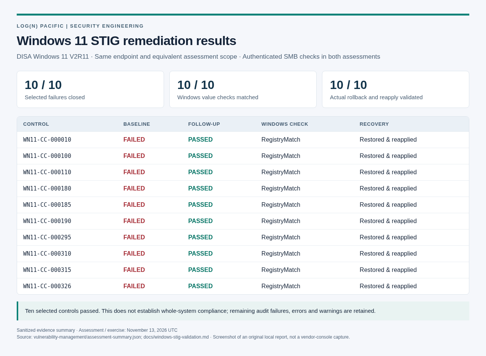

# Windows 11 STIG automation and validation

[Portfolio](../README.md) · [Results](../docs/windows-stig-validation.md) · [Evidence workflow](evidence-workflow.md) · [Tests](tests/validation.md)

Ten original PowerShell implementations have authenticated **FAILED → PASSED** results against DISA Windows 11 V2R11 on the same authorized Windows VM. Actual apply, preview, repeatability, rollback and reapply checks passed for all ten. Each control has an independent read-only verifier, failure-path tests and a technical report. See the [execution report](../docs/windows-stig-validation.md) for comparison evidence, residual findings and review provenance.



*Screenshot of the original local evidence report, derived from the [sanitized assessment record](../vulnerability-management/assessment-summary.json). It summarizes the saved results. [Image provenance](../docs/visual-evidence.md).*

## Implemented controls

All ten entries below have authenticated failed-to-passed findings. Open a report for the expected registry state, source code, tests, impact and recovery details.

| Control report | Security objective |
|---|---|
| [WN11-CC-000010](WN11-CC-000010/report.md) | The display of slide shows on the lock screen must be disabled |
| [WN11-CC-000100](WN11-CC-000100/report.md) | Downloading print driver packages over HTTP must be prevented |
| [WN11-CC-000110](WN11-CC-000110/report.md) | Printing over HTTP must be prevented |
| [WN11-CC-000180](WN11-CC-000180/report.md) | Autoplay must be turned off for non-volume devices |
| [WN11-CC-000185](WN11-CC-000185/report.md) | The default autorun behavior must be configured to prevent autorun commands |
| [WN11-CC-000190](WN11-CC-000190/report.md) | Autoplay must be disabled for all drives |
| [WN11-CC-000295](WN11-CC-000295/report.md) | Attachments must be prevented from being downloaded from RSS feeds |
| [WN11-CC-000310](WN11-CC-000310/report.md) | Users must be prevented from changing installation options |
| [WN11-CC-000315](WN11-CC-000315/report.md) | The Windows Installer feature "Always install with elevated privileges" must be disabled |
| [WN11-CC-000326](WN11-CC-000326/report.md) | PowerShell script block logging must be enabled on Windows 11 |

Four additional researched controls remain deferred for applicability or policy dependencies; see the [research shortlist](research.md) and [machine-readable catalog](catalog.json).

## Package organization

- Each control folder contains `remediate.ps1`, a separate read-only `verify.ps1`, `control.Tests.ps1`, and a technical `report.md`.
- `RegistryControl.psm1` implements the shared single-value read/change/snapshot/restore logic. All ten controls share these checks.
- `tests/Invoke-UnitTests.ps1` uses the PowerShell parser and in-memory substitutes for host, registry, and snapshot operations. It needs PowerShell 5.1 or later, without Pester or other dependencies.
- `tests/test_static.py` checks the catalog and control-specific expectations against the pinned DISA XML, documentation links, and artifact visibility. Python checks do not establish PowerShell syntax or runtime correctness.

## Prerequisites before any VM execution

1. Obtain explicit authorization for the existing participant-owned Windows 11 VM and the specific operation. Do not run remediation on the coordination workstation or another host, and do not create another VM.
2. Establish the Tenable baseline and compare the actual benchmark and rule revision. Scripts accept only the reviewed `V2R11` basis; if the active audit differs, compare and review the control before changing the implementation or using it.
3. Confirm applicability and dependencies in the control report. An already-passing setting should remain passing; never weaken it merely to manufacture a demonstration.
4. Determine the GPO/MDM policy owner and obtain permission for a local registry change. `-PolicyAuthorityConfirmed` records the caller's confirmation. Establish the policy owner before setting it. Do not use local changes to bypass central policy.
5. Review and run the safe unit tests in an authorized environment with an existing PowerShell runtime. The current parser and mocked behavior have passed in both approved runtimes; actual state changes and rollback have separately passed for the ten controls in the documented environment. Respect script-signing and execution-policy requirements; this package does not bypass them.
6. Use a 64-bit PowerShell process. Remediation requires elevation and a supported Windows 11 Pro/Enterprise/Education-family edition. Verification requires readable local state and does not require elevation. The exact target name must match the local computer; no remote targets are supported.
7. Before an actual change, prepare an approved, access-controlled local snapshot directory outside the checkout. The script requires an absolute local `.json` path, rejects network paths and paths inside this checkout, and never creates the directory. Apply-only `-WhatIf` permits a directory that does not exist yet while retaining path/scope and host checks; it does not prove the directory is writable. Restore, including `-Restore -WhatIf`, requires the original snapshot and its existing directory. The operator must verify storage permissions and any directory links; snapshots contain local host identity and must remain private.

## One-control workflow

The commands below are reusable examples for an explicitly authorized VM session. Actual execution evidence is recorded separately in each control report. Replace the target and private storage path deliberately; do not dot-source the entry-point scripts.

```powershell
# Read the stored registry value.
& .\stig-remediations\WN11-CC-000010\verify.ps1 `
    -TargetComputerName 'REPLACE-WITH-APPROVED-VM-NAME'
$LASTEXITCODE

# Preview: reads state and prerequisites, but writes no registry or snapshot.
& .\stig-remediations\WN11-CC-000010\remediate.ps1 `
    -TargetComputerName 'REPLACE-WITH-APPROVED-VM-NAME' `
    -Benchmark V2R11 -PolicyAuthorityConfirmed `
    -BackupPath 'C:\ApprovedPrivateEvidence\WN11-CC-000010-before.json' -WhatIf
```

Only after approval, invoke the same remediation without `-WhatIf` and review its confirmation prompt. Apply one control at a time. Then run the verifier, check repeat-run behavior, validate effective policy/feature behavior, and request the authorized Tenable follow-up audit. No script triggers a scan, network call, policy refresh, restart, service change, or reboot.

`verify.ps1` returns exit 0 for `RegistryMatch`, 1 for `RegistryMismatch`, and 2 for a prerequisite or read error. `remediate.ps1` returns exit 0 for a successful operation, no-op, or declined/WhatIf action; inspect its `Status` and `Changed` fields. It returns 2 on error. Every result explicitly has `PlatformValidated = false`; only separately observed platform evidence can support that claim.

Exit 0 alone must never be counted as an applied remediation. The existing exit-code contract is retained for compatibility:

| Remediation `Status` | `Changed` | Operator interpretation |
|---|---|---|
| `Changed` | `true` | Write and immediate registry recheck succeeded; effective-policy and Tenable verification still required. |
| `AlreadyMatches` | `false` | Stored value already matches; no new remediation or snapshot occurred. |
| `NotApplied` | `false` | Preview or declined confirmation; no change occurred. |
| `Restored` | `true` | Recorded prior value or absence restored. |
| `AlreadyRestored` | `false` | Stored state already matches the recovery record; no change occurred. |

Record the exit code and result fields together. An error (exit 2) after a write may leave changed state; inspect the retained snapshot and current registry state before retrying.

Registry writes do not edit GPO/MDM policy, guarantee effective behavior, or demonstrate persistence. See `WN11-CC-000063` in [research](research.md). Schedule any needed policy refresh, new session, or reboot separately; there is no universal reboot assumption for these policies. For script-block logging, check a new Windows PowerShell session and approved event evidence, without exposing sensitive script content.

## Snapshots and recovery

The first actual change captures only the named value's existence, type, original signed DWORD value, control identity, host name, and UTC time. `CreateNew` prevents overwriting an existing snapshot. A repeat application to a matching value creates no snapshot and performs no write. Existing non-DWORD values are left untouched and require manual review.

For authorized rollback, invoke that control's remediation with the original parameters and `-Restore`; preview with `-Restore -WhatIf` first. The snapshot must match the control, benchmark, host, hive, path, name, and schema. Rollback restores the prior DWORD or removes only the newly introduced value. It leaves newly created empty keys in place so unrelated policy data is never deleted.

Rollback refuses unexpected current-state drift. A second rollback is a no-op when the original value state is already restored. Snapshots are retained after restoration or failure. Treat them as trusted private recovery records: the format validates scope and types but is not cryptographically authenticated. Review the original baseline before approving rollback.

Registry changes are not transactional. A failure after a write may leave the changed value in place; the script reports an error and retains the snapshot. There is no automatic rollback. Inspect actual state and choose recovery with the operator. An external policy writer can still change state between the recheck and write.

## Safe local validation

With the explicitly supplied public DISA archive already available:

```bash
python3 stig-remediations/tests/test_static.py \
  --benchmark-archive .cache/stig-research/U_MS_Windows_11_V2R11_STIG.zip
```

Where an authorized existing PowerShell runtime is available, the non-mutating parser/unit harness can be run separately:

```powershell
& .\stig-remediations\tests\Invoke-UnitTests.ps1
```

The harness replaces all environmental I/O before invoking logic and uses only synthetic in-memory state. It does not execute remediation entry points. It cannot validate real Windows registry API behavior, policy application, ACLs, or Tenable results. Those require separately approved VM checks and scans. No tools are installed by either test runner.

Use the [evidence workflow and offline ledger](evidence-workflow.md) to record the actual benchmark, baseline, apply result, Windows verification, follow-up and independent review. The ledger has its own internal schema. [Local reproduction](../docs/local-validation.md) records observed Linux and Windows results and the existing portable-runtime procedure. A separate [offline export extractor and diagnosis runbook](tenable-readiness.md) has processed the actual authenticated baseline and follow-up without changing ledger semantics. Reviewed source headers retain their original development status; current execution status is recorded in the reports so the tested source hashes remain unchanged.
