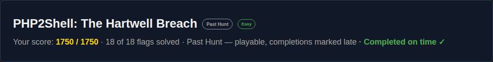
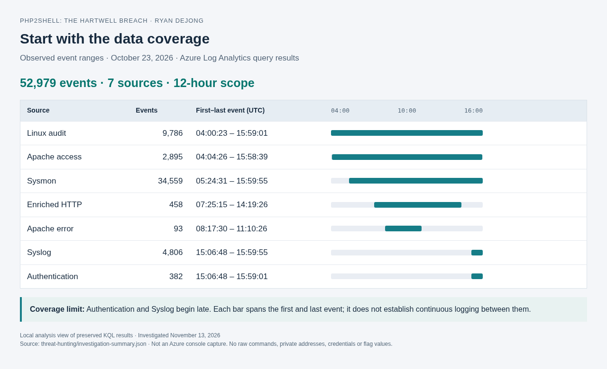

# PHP2Shell: The Hartwell Breach

[Portfolio](../README.md) · [Windows investigation](module-1/README.md) · [Investigation method](investigation-method.md)

**Threat hunt report · Ryan DeJong · November 13, 2026**

[Scope](#scope-and-tools) · [Findings](#what-happened) · [Behavior mapping](#behavior-mapping) · [Recommended response](#recommended-response)

I investigated a compromised Linux web server running WordPress, following the activity from web reconnaissance through command execution, credential access, and persistence. The work used KQL against seven log sources in an authorized Cyber Range training dataset.

The strongest evidence came from connecting HTTP requests to host activity. A suspicious request became much more meaningful when a filesystem event, a new web endpoint, and a web-server child process supported the same explanation. I also checked whether the attacker's attempts to stop monitoring worked and whether the available records supported lateral movement.

**Result:** 18/18 flags, 1,750/1,750 points, completed within the competition window. The technical findings and their limits are documented below.



*Screenshot from the completed hunt. The page now labels the competition as a past hunt; my result still shows “Completed on time.” Only the original title and my completion indicator are shown. [Screenshot provenance](../docs/visual-evidence.md).*

## Scope and tools

| Item | Scope |
|---|---|
| Environment | One Linux/WordPress scenario host; historical training telemetry |
| Event window | October 23, 2026, 04:00–16:00 UTC, narrowed for individual questions |
| Query platform | Azure Log Analytics and Kusto Query Language (KQL) |
| Analysis | HTTP and host-event correlation, process ancestry, safe decoding, timeline reconstruction, and scope checks |
| Supporting tools | Python for checking transformations and evidence hashes |
| Response work | Recommendations only; no containment or recovery was performed on the scenario host |

### Check coverage before drawing conclusions

The scoped dataset contained **52,979 events**. These are log records, not 52,979 attacks or unique actions.

| Source | Events | What it contributed |
|---|---:|---|
| Apache access | 2,895 | Request patterns, new URIs, and HTTP status codes |
| Apache error | 93 | PHP warnings and application-side context |
| Enriched HTTP | 458 | Request metadata and decoded command fields |
| Sysmon | 34,559 | Process creation, parent processes, and available network events |
| Linux audit | 9,786 | Filesystem activity and corroborating host evidence |
| Authentication | 382 | Available login and service-related context |
| Syslog | 4,806 | System and monitoring-related messages |



*Screenshot of my local evidence review, built from the preserved KQL results. This is an analysis view, not an Azure console screenshot. The bars show the first and last observed event for each source; they do not imply uninterrupted logging.*

Authentication and Syslog records started after the main command window. Some normalized network fields were empty. Those gaps mattered when assessing what I could reasonably rule out.

This is a shortened version of the coverage query. The time parameters are deliberately empty; they must be set for an authorized dataset before use. It omits the original query's `TimeGenerated` comparisons because those values do not establish ingestion time.

```kusto
let Begin = datetime(null);
let End = datetime(null);
union withsource=SourceTable
    HartwellApache_CL, HartwellApacheError_CL,
    HartwellHTTPEnriched_CL, HartwellSysmon_CL,
    HartwellAudit_CL, HartwellAuth_CL, HartwellSyslog_CL
| where isnotnull(Begin) and isnotnull(End)
| where OriginalTime between (Begin .. End)
| summarize Events=count(),
            FirstEvent=min(OriginalTime),
            LastEvent=max(OriginalTime) by SourceTable
| order by FirstEvent asc
```

## What happened

The sequence below combines several sources. It is not a second-by-second synchronized timeline: an apparent offset between application error and HTTP records remained unresolved.

| Stage | Evidence I followed | Conclusion |
|---|---|---|
| Reconnaissance | Repeated probes, request volume, and scanner-identifying user-agent records | The traffic included deliberate reconnaissance rather than ordinary browsing alone. |
| Exploitation and foothold | Upload-related request characteristics, PHP warnings, audit filesystem events, and a newly requested PHP endpoint | Multiple sources supported the transition from probing to a webshell. A warning alone did not prove the exploit mechanism. |
| Remote command execution | Apache-parented processes and enriched HTTP command metadata | The attacker obtained command execution in the web-service account's context. |
| Discovery and credential access | Host/network discovery commands, monitoring enumeration, configuration reads, and SQL query metadata | The attacker investigated the host and accessed application/database credential material. Exact returned contents were not collected. |
| Attempted monitoring disruption | Service-stop commands followed by continuing process, audit, and monitoring-related activity | The evidence supported attempted suppression, not sustained loss of all monitoring. |
| Persistence and scope | Scheduling commands, a staged implant, HTTP responses, and scoped process/command checks | Commands to establish persistence were observed. The available command records did not establish lateral movement. |

### 1. Connect the web activity to execution

I started with access-log patterns, then used application errors and enriched HTTP records to narrow the suspicious requests. The important step was corroboration: Linux audit events supported a new file in the web root, later access logs showed requests to that endpoint, and Sysmon recorded child processes associated with the web server.

That chain supported successful command execution. It was stronger than treating every unusual request or PHP warning as a successful exploit. I did not attribute a specific CVE from the available evidence.

For process triage, I grouped executable and parent-process pairs before inspecting a smaller set of command records. This excerpt follows the same approach; the account and time bounds are withheld parameters. The shortened queries in this report were not rerun against the service.

```kusto
let Begin = datetime(null);
let End = datetime(null);
let WebAccount = "";
HartwellSysmon_CL
| where isnotnull(Begin) and isnotnull(End) and isnotempty(WebAccount)
| where OriginalTime between (Begin .. End)
| where toint(EventID) == 1 and User == WebAccount
| summarize ProcessEvents=count(),
            FirstSeen=min(OriginalTime),
            LastSeen=max(OriginalTime) by Image, ParentImage
| order by ProcessEvents desc
```

### 2. Verify the hidden command channel

Standard access logs did not provide the full command context. Enriched HTTP records exposed the additional request metadata needed to understand how the webshell was operated.

I checked four raw/decoded command pairs as data. Reapplying the candidate transformations reproduced all four observed encoded values exactly; alternative transformation orders did not match. I then compared the decoded activity with host-process evidence. No decoded command was executed during the analysis.

This established the tested encoding order for those samples. It did not prove that every encoded request in the dataset used the same scheme. The custom header name, payload names, and exact flag values remain private.

### 3. Follow discovery and credential access

Process records showed the attacker inspecting network configuration, neighboring systems, listening services, and the monitoring stack. Later activity accessed application configuration and queried user records in the database.

I retained the query structure and relevant table/column metadata without collecting password or hash values. Configuration and database reads lined up with webshell requests and responses. Response metadata supported data returning over the existing webshell channel, but the response bodies were not retrieved. Early HTTP errors were not counted as successful extraction, and I did not claim a confirmed number of stolen records.

### 4. Test whether the monitoring disruption worked

The attacker tried to stop monitoring services. A stop command in a process log only establishes an attempt, so I checked what happened afterward.

The follow-up window contained **608 Sysmon events** and **385 audit events**. It also contained **7 forwarder-related process events**, which are a subset of the Sysmon count, not seven additional independent events. That continued activity supported the conclusion that monitoring was not persistently silenced.

The available records did not include every command's exit code or output. The web-service account's limited privileges provided context, but continued telemetry was the observable basis for the outcome assessment. Short gaps in monitoring were not ruled out.

### 5. Assess persistence and incident scope

Scheduling commands and a staged implant supported an attempt to maintain access. The staging path pointed to a location normally backed by volatile storage, which would matter for evidence collection before a restart. I did not inspect the target's mount configuration, swap behavior, or implant contents, so I did not claim the artifact was forensically unrecoverable. An installation command alone did not prove that later scheduled executions succeeded.

For lateral movement, I reviewed **71 web-account process-creation records** and **45 decoded webshell commands** in the narrowed window. The scoped checks found no remote-login tools, explicit remote database host options in the process records, or references to additional internal destinations in those reviewed commands.


*Screenshot of my local analysis review, using preserved query results. Counts describe the reviewed records and checks. They do not establish complete network visibility or prove that no other activity occurred.*

My conclusion was **no lateral movement evidenced in the reviewed scope**. Empty destination, port, and initiation fields prevented a complete network-level conclusion. I did not turn missing fields into “no connections” or classify an empty destination as a verified external address.

## Behavior mapping

These are analyst mappings of the supported behavior, not attribution to a named threat group. ATT&CK describes the techniques; the investigation evidence determines whether an attempt or outcome was observed.

| Behavior | ATT&CK reference | Assessment |
|---|---|---|
| Webshell-based access | [T1505.003 — Web Shell](https://attack.mitre.org/techniques/T1505/003/) | Corroborated by web, filesystem, and process records. |
| Access to credential-bearing configuration | [T1552.001 — Credentials In Files](https://attack.mitre.org/techniques/T1552/001/) | File/query activity observed; secret values excluded from collection and publication. |
| Attempts to disable monitoring | [T1685 — Disable or Modify Tools](https://attack.mitre.org/techniques/T1685/) | Attempt observed; subsequent monitoring activity remained visible. |
| Recurring execution mechanism | [T1053 — Scheduled Task/Job](https://attack.mitre.org/techniques/T1053/) | Installation command observed; later scheduled execution was not verified. |
| Data returned through the command channel | [T1041 — Exfiltration Over C2 Channel](https://attack.mitre.org/techniques/T1041/) | Supported channel interpretation; response contents and total data loss were not independently established. |

## Recommended response

These are proposed actions for an authorized response team, not actions performed during this hunt:

1. Preserve volatile host evidence, relevant logs, and the web application state before restarting or rebuilding the server.
2. Contain the compromised web service while preserving an approved recovery path. Investigate and correct the entry point before returning it to service.
3. Rotate exposed application/database credentials and assess affected user accounts. Establish the actual exposure from retained evidence rather than assuming every database record was stolen.
4. Remove the webshell and persistence, verify monitoring health, and validate recovery from a trusted state.
5. Expand the scope with usable network and authentication evidence. Review other assets only with explicit authorization.

Detection improvements would focus on web-server processes spawning shells, new executable content under the web root, monitoring-service stop attempts, and unexpected scheduled execution. Correlating those behaviors with HTTP activity is more useful than depending on one payload filename or attacker-controlled header.

## Lessons and evidence

The most useful habit in this investigation was asking what each record actually proved. A request was not execution, a stop command was not a stopped service, and an empty network field was not evidence of no traffic. Checking source coverage early kept those distinctions clear.

The [sanitized evidence summary](investigation-summary.json) records the counts used here. Private records retain the executed queries, source results, timestamps, and integrity manifests; **34 hunt evidence files were rechecked against their saved hashes** while preparing this report. Hash agreement verifies preserved bytes, not the completeness or independent authenticity of the source telemetry.

Screenshots include one actual application capture and two clearly labeled local analysis views. No result values were invented or changed. Private addresses, credentials, exact challenge answers, raw commands, and participant scoreboard information are excluded. [Capture details and image hashes](../docs/visual-evidence.md).

For related work, see the [separate Windows investigation](module-1/README.md), [reusable investigation method](investigation-method.md), and [authentication detection and Sentinel workbook](../cyber-defense/README.md). Those are separate projects; their results are not presented as findings from this hunt.
