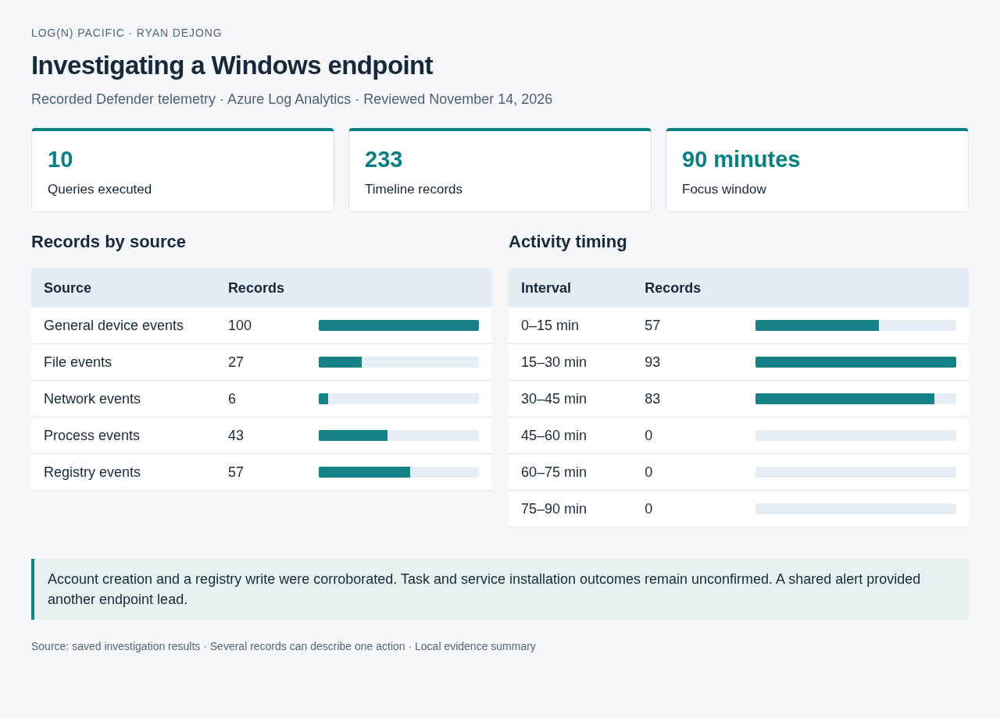

# Windows endpoint investigation with Defender KQL

[Portfolio](../../README.md) · [Investigations](../README.md) · [Query index](#query-index) · [Execution results](#observed-execution-and-limits)

I investigated suspicious activity on a Windows endpoint using historical Cyber Range telemetry. I wrote and executed ten KQL queries to trace processes, network connections, file changes, registry activity and account changes. The investigation produced a 233-record timeline, an incident report and a containment proposal.

## Findings

I first checked which event sources covered the incident window. The initial 90-minute window contained process and host activity but missed earlier authentication events. A separate query within the authorized wider window supplied that context.

I then used process ancestry and related host events to assess what had happened. Account creation and a registry write had corroborating events. Commands to create a task and service were present; the available results did not confirm whether either mechanism was installed. A shared alert linked another endpoint, leaving a lead for further investigation.

| Evidence | Finding | Follow-up |
|---|---|---|
| Account events | Account creation was supported by a host event. | Review the account's purpose and related group changes. |
| Registry events | A registry value write corroborated part of the observed activity. | Check the setting and any subsequent execution before concluding that persistence worked. |
| Task and service commands | Creation commands appeared in process telemetry. | Confirm the resulting task or service state. |
| Shared alert | The alert associated another endpoint with the incident. | Establish that endpoint's role before concluding lateral movement. |
| Network query | The scoped lateral-movement query returned no matches. | Review the available coverage and alert lead; the result alone cannot close that branch. |

The containment proposal prioritizes evidence preservation, confirmation of the affected identities, and scoped endpoint containment with a recovery path. No response action was performed on the investigated hosts.

*Local summary of saved investigation results. [Source data](investigation-summary.json) · [Image details](../../docs/visual-evidence.md).*

## Timeline and coverage

The combined timeline contains 100 general device events, 57 registry events, 43 process events, 27 file events and six network events. Several records can describe the same action.

| Elapsed time in the focus window | Records |
|---|---:|
| First 15 minutes | 57 |
| Minutes 15–30 | 93 |
| Minutes 30–45 | 83 |
| Minutes 45–90 | 0 |

Activity clustered in the first 45 minutes. The [Sentinel workbook](../../cyber-defense/workbooks/README.md) presents these counts alongside source, event-type and query coverage.

## Scope and execution

The queries use Defender event tables and were executed in the authorized Azure Log Analytics workspace. Each source query starts with null UTC bounds and an empty device list. An initial service check confirmed that all ten bound successfully and returned no rows with that empty scope.

For reuse, set the approved device IDs and a half-open UTC window in a private copy. Run the coverage query first. Keep device and time filters intact, record query hashes and response limits, and correlate process IDs with their creation times. Preserve raw event details privately. [Investigation method](../investigation-method.md).

## Query index

| Query | Question and interpretation limit |
|---|---|
| [00 Coverage](queries/00-coverage.kql) | Which tables/actions and time ranges are present? Check retention and gaps. |
| [01 Authentication](queries/01-authentication.kql) | Who attempted access, from where, with what outcome and logon type? Confirm outcome semantics before counting. |
| [02 Processes](queries/02-processes.kql) | Which administrative binaries or encoded-command indicators deserve review? Review legitimate uses and the filter's coverage. |
| [03 Network](queries/03-network.kql) | Which destinations and initiating processes were observed? An event does not automatically prove a session, download or exfiltration. |
| [04 Files](queries/04-files.kql) | Which files changed, with which hashes/origins? Creation does not prove execution; empty SHA256 is common. |
| [05 Registry](queries/05-registry-persistence.kql) | Were common persistence-related locations modified? A write is not proof persistence executed; coverage is deliberately partial. |
| [06 Tasks and services](queries/06-tasks-services.kql) | Were creation commands invoked? Corroborate with events/state; API/WMI and other creation methods may be missed. |
| [07 Accounts/privileges](queries/07-accounts-privileges.kql) | Which account and group events or administrative commands occurred? Validate event payloads; actor fields may differ from the affected account. |
| [08 Potential lateral movement](queries/08-lateral-movement.kql) | Did scoped devices contact administrative-service ports? Ports alone do not establish movement or authorize inspection of destinations. |
| [09 Timeline](queries/09-timeline.kql) | How do recorded events align across sources? Retain source table, device, timestamp and ReportId; inspect full source rows for details. |

## Observed execution and limits

All ten queries ran successfully against the assigned historical data. The retained query and response hashes were verified. The final responses used for the public summary were complete; an earlier capped response remains excluded from exhaustive conclusions.

Task and service installation outcomes remain unconfirmed. The alert-linked endpoint was reviewed only through its device name, alert IDs and timestamps; its raw telemetry and host state were outside the investigation scope. These limits remain in the incident report.

The private record `EV-MODULE1-V17` retains the executed queries, result hashes, timestamps, incident analysis and containment proposal. [Validation and source context](../../docs/local-validation.md#review-and-disclosure-checks).

## Public technical references

Column selection follows Microsoft's tables for [logons](https://learn.microsoft.com/en-us/defender-xdr/advanced-hunting-devicelogonevents-table), [processes](https://learn.microsoft.com/en-us/defender-xdr/advanced-hunting-deviceprocessevents-table), [network events](https://learn.microsoft.com/en-us/defender-xdr/advanced-hunting-devicenetworkevents-table), [file events](https://learn.microsoft.com/en-us/defender-xdr/advanced-hunting-devicefileevents-table), [registry events](https://learn.microsoft.com/en-us/defender-xdr/advanced-hunting-deviceregistryevents-table) and [general device events](https://learn.microsoft.com/en-us/defender-xdr/advanced-hunting-deviceevents-table). Check the deployed portal schema and permissions before execution. Document any necessary adaptations and rerun their tests.
