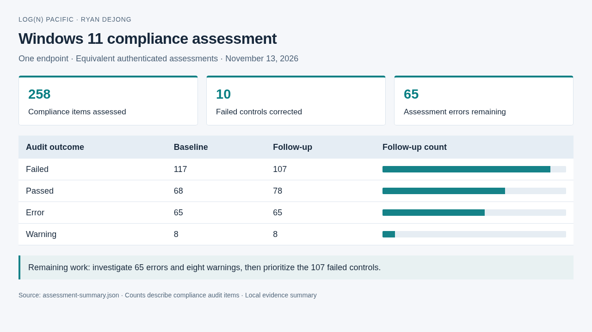

# Vulnerability management program

[Portfolio](../README.md) · [STIG implementations](../stig-remediations/README.md) · [Assessment evidence](../docs/windows-stig-validation.md)

I completed a vulnerability-management cycle on one Windows 11 endpoint: define the scope, establish an authenticated baseline, prioritize findings, apply PowerShell remediations and run a comparable follow-up assessment. **Ten selected DISA Windows 11 V2R11 controls changed from FAILED to PASSED** on November 13, 2026. The [execution report](../docs/windows-stig-validation.md) links the detailed control reports.

The project also includes a proposed program policy, a stakeholder tabletop exercise and a queue for the remaining findings. The policy and tabletop are authored exercises. The assessment results and Windows changes were observed on the authorized endpoint.



*Screenshot of the original local assessment report. The [source record](assessment-summary.json) retains unresolved outcomes alongside the ten closures. [Image provenance](../docs/visual-evidence.md).*

## Deliverables and evidence

| Program stage | Completed artifact or observation |
|---|---|
| Inventory and scope | ASSET-A: one authorized Windows 11 Pro 25H2 VM, build 26200. Private networking, no public IP, existing management preserved. Exact identifiers and credentials remain private. |
| Policy and responsibilities | Original [program policy proposal](program-policy.md), with asset ownership, assessment gates, exception handling and review cadence. It remains a proposal. |
| Stakeholder coordination | Original [governance tabletop](governance-exercise.md): scope negotiation, policy revisions, assessment permission, remediation handoff and change review. Fictional roles are separated from actual operator authorization. |
| Assessment | One-host authenticated baseline; credentialed SMB and registry-access diagnostics; 258 compliance items. Original XML hashes and sanitized counts are in [assessment-summary.json](assessment-summary.json). |
| Prioritization | Select real failed, applicable rules with clear expected state, reversible changes and low management impact. Record control severity from the benchmark; do not invent CVSS scores for STIG rules. |
| Implementation | Ten original [PowerShell packages](../stig-remediations/README.md), with target checks, preview, snapshots, idempotence, read-only verification and guarded restore. |
| Change validation | 110 execution-stage records rechecked across the ten controls; all 154 retained Windows records and all 33 reviewed source hashes reverified. |
| Reassessment | Same host identity and equivalent saved configuration; authenticated follow-up returned ten passes. No repeat scan was necessary for this evidence review. |
| Reporting and maintenance | Individual reports, aggregate metrics, residual assessment queue and a bounded repeat-assessment procedure. No recurring scan or response automation is deployed. |

## Measured results

| Audit result | Baseline | Follow-up |
|---|---:|---:|
| FAILED | 117 | 107 |
| PASSED | 68 | 78 |
| ERROR | 65 | 65 |
| WARNING | 8 | 8 |
| Total compliance items | 258 | 258 |

All ten selected failures closed. The failed audit-item count fell by 8.55%. The follow-up still had 107 failures, 65 errors and eight warnings. These remain open for review. This percentage measures audit-item closure; overall risk reduction was not measured.

Reproduce the arithmetic and consistency gates locally:

```bash
python3 -B vulnerability-management/metrics.py
python3 -B -m unittest discover -s tests -p test_program_metrics.py -v
```

The tool rejects missing authentication/equivalence assertions, duplicate controls, inconsistent totals and attempts to count errors as passes. It validates the sanitized record's consistency. Authenticity and scan comparability still depend on the retained original evidence and private configuration records.

## Assessment and change record

The baseline ran 12:14:59–12:22:13 UTC and the follow-up 12:38:50–12:45:15 UTC on November 13. Both used Nessus 10.12.6 and feed 202611121400. The configured audit was DISA Windows 11 V2R11, with exact exported Rule IDs reconciled to the catalog. Audit-content digests were unavailable; matching audit filenames alone were not used as authenticity proof.

The engineer first established host discovery and authenticated access. Temporary scanner-specific prerequisites were captured, applied within approved assessment windows, and restored. The initial empty scan remains recorded as an unsuccessful assessment. Its unique root cause remains unproven because several prerequisite conditions changed.

Each selected remediation followed: observe → preview → apply → verify → repeat → restore preview → restore → verify original absence → repeat restore → reapply → verify. These actions used the unchanged reviewed package. Source and snapshot integrity were checked. Native script-block logging was additionally observed through a specific new-process marker; every UI effect, reboot and future policy refresh was not tested.

## Residual work and next cycle

| Queue | Next evidence needed | Release condition |
|---|---|---|
| 107 remaining failed items | Per-item applicability, security impact, asset dependencies and reversible plan | A separately approved control batch; never change the denominator to claim full compliance. |
| 65 errors | Exact audit-check error, collection prerequisite and applicable benchmark guidance | Resolve the assessment failure, then reassess; keep its outcome unresolved until the check succeeds. |
| 8 warnings | Required manual evidence and reason for warning | Analyst-supported disposition and equivalent follow-up evidence. |
| Persistence of the ten changes | Policy-refresh/reboot window and effective-behavior checks where necessary | Approved window preserving management and same VM continuity. |
| Continuous operation | Named owner, maintenance window, export retention and scan authorization | Approved schedule and protected authentication; no automatic recurring operation currently exists. |

The existing [Tenable client and runbook](../stig-remediations/tenable-readiness.md) supply narrow configuration, assessment and export handling. Before another cycle, revalidate the exact asset, scanner, audit, authentication and approved temporary prerequisite window. Preserve the old assessment instead of overwriting it. Close a finding only after comparable evidence, and preserve a negative result or rollback as part of the record.

## Scope and attribution

The course-linked [program example](https://github.com/joshcybertest/vulnerability-management-program) informed the lifecycle: policy, stakeholder exercises, assessment, remediation and maintenance. This project adapts that structure to the existing Windows 11 endpoint and its observed compliance findings. The example's separate Windows Server and software-remediation exercises were not performed.

[NIST SP 800-40 Rev. 4](https://csrc.nist.gov/pubs/sp/800/40/r4/final) provides the public reference for preventive maintenance, prioritization and verifying changes. The policy contains original proposals for this lab. AI assistance supported code, tests and evidence review. The operator authorized execution. Publication and external acceptance have separate approval records.
